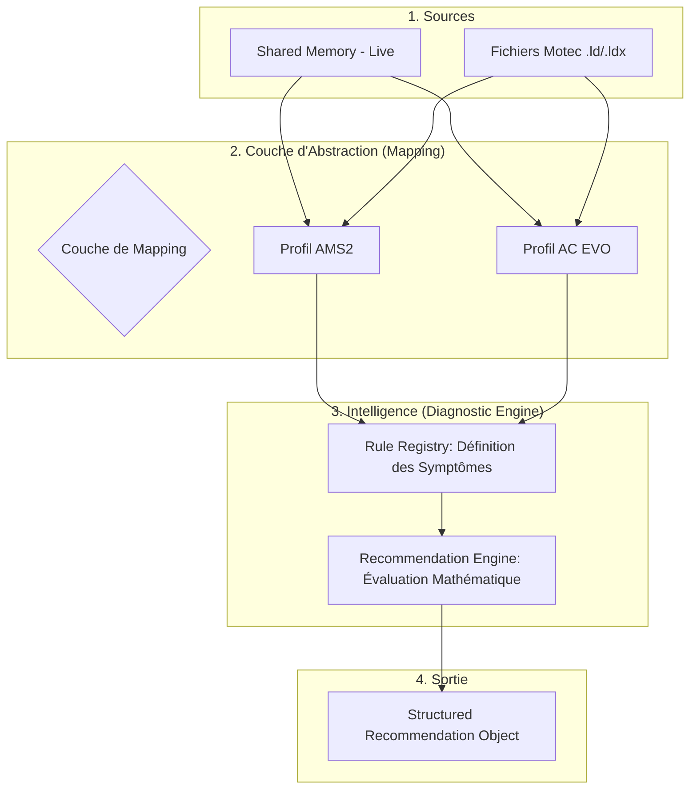

# Spécifications du Système de Mapping des Données (Motec & Shared Memory)

## 1. Objectif
L'objectif est de découpler la logique d'analyse et de recommandation de la source technique des données. En utilisant un système d'**Alias**, l'application devient agnostique vis-à-vis du simulateur (Profil) et du mode d'acquisition (Live vs Fichier).

## 2. Architecture Conceptuelle

Le système complet suit un flux de données allant de la source brute jusqu'à une recommandation structurée et actionnable.



Le flux est le suivant : **Sources** $\rightarrow$ **Mapping (Aliases)** $\rightarrow$ **Registry (Symptômes/Causes)** $\rightarrow$ **Engine (Calculs)** $\rightarrow$ **Recommandation**.

## 3. Table de Correspondance (Mapping)

Cette table définit comment chaque **Alias** est résolu selon le profil et la source.

| Alias Application | Type | Unité Standard | Profil AMS2 (Motec) | Profil AMS2 (Live/SM) | Profil AC EVO (Motec) | Profil AC EVO (Live/SM) |
| :--- | :--- | :--- | :--- | :--- | :--- | :--- |
| `Engine_RPM` | Raw | RPM | Engine RPM | `mRpm` | RPMS | `rpms` |
| `Gear` | Raw | - | Gear | `mGear` | GEAR | `gear` |
| `Throttle_Pos` | Raw | % | Throttle Pos | `mThrottle` | THROTTLE | `gas` |
| `Brake_Pos` | Raw | % | Brake Pos | `mBrake` | BRAKE | `brake` |
| `Clutch_Pos` | Raw | % | Clutch Pos | `mClutch` | CLUTCH | `clutch` |
| `Steering_Angle` | Raw | deg / % | Steering Pos | `mSteering` | STEERANGLE | `steerAngle` |
| `Vehicle_Speed` | Raw | km/h | Ground Speed | `mSpeed` | SPEED | `speedKmh` |
| `G_Lat` | Raw | G | G Force Lat | `mLocalAccel[0]` | G_LAT | `accG[0]` |
| `G_Long` | Raw | G | G Force Long | `mLocalAccel[2]` | G_LON | `accG[2]` |
| `Fuel_Level` | Raw | L | Fuel Level | `mFuelLevel` | FUEL | `fuel` |
| `Tyre_Temp_FL` | Raw | °C | Tyre Temp FL | `mTyreTemp[0]` | TYRE_TAIR_LF | `tyreCoreTemp[0]` |
| `Tyre_Press_FL` | Raw | kPa | Tyre Pressure FL | `mTyrePress[0]` | TYRE_PRESS_LF | `wheelsPress[0]` |
| `Rake` | Virtual | cm/mm | (Calculé) | (Calculé) | (Calculé) | (Calculé) |

## 4. Recommandations d'Implémentation

### 4.1 Normalisation des Unités et Types
Les sources ne partagent pas les mêmes unités ni les mêmes types. Le système doit supporter :
- **Types** : `float` (température), `int` (rapport), `bool` (flags ABS/TCS).
- **Conversions** : 
    * Vitesse : $m/s \rightarrow km/h$ ($\times 3.6$).
    * Pression : $psi \rightarrow kPa$ ($\times 6.89476$).
    * Accélération : $m/s^2 \rightarrow G$ ($\div 9.80665$).

### 4.2 Canaux Virtuels (Calculated Values)
Certaines données ne sont pas présentes nativement mais doivent être calculées à partir d'autres alias.
- **Exemple Rake** : `Rake = ((RideHeight_FL + RideHeight_FR)/2) - ((RideHeight_RL + RideHeight_RR)/2)`
- **Implémentation** : Le `DataProvider` doit vérifier si l'alias est de type `Virtual`. Si oui, il exécute la formule associée en récupérant les valeurs des alias dépendants.

### 4.3 Gestion du Temps et Fallbacks
- **Abstraction Temporelle** : Créer un alias `Session_Time` pour uniformiser le temps entre le mode Live (Real-time) et Fichier (Motec Timestamp).
- **Données Manquantes** : Si une donnée est absente pour un profil, le système doit retourner `NaN` ou une valeur sentinelle pour éviter de fausser les analyses.

### 4.4 Configuration Externe (JSON/YAML)
Pour éviter la recompilation à chaque modification de channel, le mapping doit être stocké dans un fichier externe :
```json
{
    "channelMappings": [
        { "alias": "Engine_RPM", "profile": "AMS2", "source": "MOTEC", "channel": "Engine RPM", "unit": "RPM", "sourceUnit": "RPM", "factor": 1.0, "offset": 0.0 },
        { "alias": "Engine_RPM", "profile": "AMS2", "source": "LIVE", "channel": "mRpm", "unit": "RPM", "sourceUnit": "RPM", "factor": 1.0, "offset": 0.0 },
        { "alias": "Engine_RPM", "profile": "EVOM1", "source": "MOTEC", "channel": "RPMS", "unit": "RPM", "sourceUnit": "RPM", "factor": 1.0, "offset": 0.0 },
        { "alias": "Engine_RPM", "profile": "EVOM1", "source": "LIVE", "channel": "rpms", "unit": "RPM", "sourceUnit": "RPM", "factor": 1.0, "offset": 0.0 }
    ]
}
```

The application loads `channelMappings` from `MotecDataAnalyser.mapping.json` beside the executable or from its `config` subfolder. Each entry is keyed by application alias, profile, and source (`MOTEC` or `LIVE`); the source channel is converted with `value * factor + offset`. Entries with the same key replace earlier entries. This file is separate from `MotecDataAnalyser.rules.json`, which configures diagnostic rules and legacy channel-name aliases.

The checked-in mapping inventory covers all unique channel names listed in `AMS2_channels.md` and `AC_EVO_channels.md`. Live entries use fields present in the corresponding shared-memory headers; channels without a direct live equivalent have no fabricated live mapping. Flag bitfields are exposed as raw bitmasks and require a later virtual/bitfield calculation step.

Raw and virtual entries share the same `channelMappings` array. Raw entries may use `type: "raw"` (omitted `type` is treated as raw for compatibility); virtual entries use `type: "virtual"`. `Rake` uses the `difference_of_averages` operation: it averages `Ride_Height_FL`/`Ride_Height_FR` and subtracts the average of `Ride_Height_RL`/`Ride_Height_RR`. The provider returns no value if any required input is missing. Evo Live exposes front/rear axle heights, so the LapStats bridge supplies each axle value to its two corresponding corner aliases.

### 4.5 Standardisation de l'Indexation des Pneus
Un index standard doit être adopté pour tous les tableaux :
* `0` $\rightarrow$ Front Left (FL) | `1` $\rightarrow$ Front Right (FR)
* `2` $\rightarrow$ Rear Left (RL)  | `3` $\rightarrow$ Rear Right (RR)

### 4.6 Pattern de Code Suggéré (C++)
L'utilisation d'un `DataProvider` permet de masquer la complexité :

```cpp
class DataProvider {
public:
    float getValue(Alias alias) {
        auto mapping = m_mappingTable[m_currentProfile][alias];
        
        if (mapping.type == Type::VIRTUAL) {
            return calculateVirtualValue(mapping.formula);
        }

        float rawValue = (m_mode == Mode::LIVE) 
                         ? m_sharedMemory->read(mapping.liveSource) 
                         : m_motecFile->getChannel(mapping.motecSource);

        return rawValue * mapping.conversionFactor;
    }
private:
    Profile m_currentProfile; 
    Mode m_mode;              
};
```

## 5. Logique de Diagnostic & Recommandations

Une fois les données abstraites via le mapping, elles alimentent la couche d'intelligence du système. Cette couche est composée de deux éléments clés :

### 5.1 Le Registre des Symptômes (`Rule Registry`)
Le registre contient une collection de `RuleSymptom` qui définissent l'expertise métier. Chaque symptôme comprend :
* **ID Unique** : Utilisé par le moteur pour identifier la règle (ex: `tyre_temp_imbalance`).
* **Causes & Poids** : Une liste de causes potentielles associées à un poids ($0.0$ à $1.0$). Cela permet au système d'exprimer l'incertitude (ex: "Camber" est plus probable que "Pressure").
* **Actions Correctives** : Pour chaque cause, une action suggérée et sa direction (`increase`, `decrease`, etc.).
* **Canaux de Validation** : Les alias nécessaires pour confirmer la présence du symptôme.

### 5.2 Le Moteur de Recommandation (`Recommendation Engine`)
Le moteur exécute le calcul mathématique en temps réel sur les données fournies par l'abstraction. Son rôle est de :
1. **Évaluer les conditions** : Comparer les valeurs des alias (ex: `Inner_Temp` vs `Outer_Temp`) à des seuils définis.
2. **Calculer la Confiance (`Confidence Score`)** : Déterminer la force du signal en fonction de l'ampleur du dépassement du seuil et de la qualité/répétabilité des données.
3. **Générer une Recommandation Structurée** : Produire un objet `Recommendation` contenant le symptôme, les preuves textuelles (`evidence`), et les suggestions d'ajustement basées sur le registre.

```cpp
// Exemple de flux logique simplifié
void RecommendationEngine::analyze(const DataProvider& data) {
    double inner = data.getValue("TYRE_TEMP_FL_INNER");
    double outer = data.getValue("TYRE_TEMP_FL_OUTER");
    
    if (std::abs(inner - outer) > threshold) {
        Recommendation rec;
        rec.symptom = "tyre_temp_imbalance";
        rec.confidence = calculateConfidence(...);
        rec.evidence.push_back("Diff: " + std::to_string(inner - outer));
        m_results.push_back(rec);
    }
}
```

## 6. Avantages de cette approche
1. **Lisibilité** : Le code d'analyse utilise `Engine_RPM` au lieu de variables cryptiques comme `mRpm`.
2. **Flexibilité** : L'ajout d'un nouveau simulateur se résume à l'ajout d'une colonne dans la table de mapping.
3. **Robustesse** : Les erreurs de conversion d'unités sont centralisées et traitées une seule fois à l'entrée des données.
4. **Intelligence Découplée** : La logique métier (les règles) est séparée de la technique (le mapping), permettant de modifier les seuils ou les causes sans toucher au code d'acquisition.
